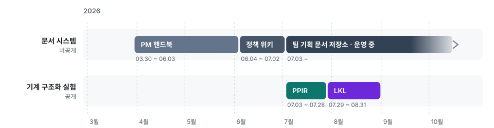

<p align="center">
  
</p>

<h1 align="center">Product Planning IR (PPIR)</h1>

<p align="center">
  기획 결정을 구조화된 그래프로 관리하고,<br>
  현재 유효한 결정과 근거를 추적하는 기획 지식 시스템
</p>

<p align="center">
  <a href="https://github.com/hadan-HwH/product-planning-ir/actions/workflows/verify.yml">
    
  </a>
  
  <a href="https://github.com/hadan-HwH/living-knowledge-lab-engine"></a>
</p>

<p align="center"><sub>개인 연구 프로젝트 · 2026.07 · 개발 중단</sub></p>

---

## 프로젝트 소개

> 후속 연구는 [LKL](https://github.com/hadan-HwH/living-knowledge-lab-engine)에서 이어졌습니다.

기획 문서에서는 같은 규칙이 여러 곳에 복제되고, 결정이 바뀌어도 이전 내용이 그대로 남습니다. 어느 내용이 현재 기준인지 판단하기 어렵고, 문서를 잘라 검색하는 AI(RAG)도 이미 뒤집힌 결정을 현재 결정처럼 가져옵니다.

<b>Product Planning IR(PPIR)</b>은 기획 지식을 타입과 고유 ID를 가진 작은 단위(atom)로 나누고, 서로 참조하는 **그래프**로 관리합니다. 결정은 시간순 이벤트로 기록하며, 현재 유효한 결정은 최신 메시지가 아니라 **이벤트 이력을 계산해서** 정합니다.

목표는 사람이 읽는 문서와 AI에 전달하는 맥락을 **모두 하나의 그래프에서 생성하는 것**입니다.

## 주요 기능

| 기능 | 설명 |
| --- | --- |
| **결정 이력 관리** | 채택 · 대체 · 보류 · 재개 등 결정 이벤트를 기록하고 현재 유효한 결정을 계산합니다. |
| **근거 추적** | 모든 항목을 출처와 결정에 연결하고, 끊긴 근거 연결을 검출합니다. |
| **AI용 맥락 생성** | 현재 결정과 사용하면 안 되는 이전 결정을 구분한 Context Pack을 생성합니다. |
| **단일 변경 경로** | 모든 변경은 제안(Proposal) → 검증 → 반영 순서를 거치며, 검증에 실패하면 전체를 되돌립니다. |
| **미확정 사항 관리** | 근거가 없는 내용은 지어내지 않고 미결 질문(OpenQuestion)으로 남깁니다. |

### 산출물 예시

공개 데모에는 PPIR 자신의 설계 결정 이력이 데이터로 포함되어 있습니다. 아래는 그 그래프에서 생성한 AI용 Context Pack입니다.

```markdown
# Context Pack — D2IR.TARGET.knowledge_representation

## Authority — the current decision
- ✅ decision_graph — 결정 진화 그래프

### Inactive — MUST NOT use as current
- 🚫 markdown_clause — replaced_by_typed_ir_ssot
- 🚫 typed_ir_ssot — replaced_by_decision_graph
```

<details>
<summary><b>결정 타임라인 보기</b></summary>

<br>

```
Timeline — D2IR.TARGET.knowledge_representation:
  2026-07-03  adopt_option      markdown_clause
  2026-07-06  replace_option    markdown_clause → typed_ir_ssot
  2026-07-07  replace_option    typed_ir_ssot → decision_graph
→ Current: decision_graph
```

</details>

### 평가 결과

같은 자료(회의 3건, 영업 의견 2건)에서 "현재 유효한 결정은 무엇인가"를 물었을 때의 비교입니다.

| 방식 | 판단한 현재 결정 | 타임라인 정확도 | 맥락 오염률 |
| --- | :---: | :---: | :---: |
| 문서 검색(RAG) | a (이후 영업 의견에 오도됨) | 0.40 | 0.80 |
| **PPIR** | **a2 (정답)** | **1.00** | **0.00** |

<sub>합성 데이터 1건으로 핵심 동작을 확인한 결과이며, 일반화 성능을 의미하지 않습니다.</sub>

## 기술적 접근

<picture>
  <source media="(prefers-color-scheme: dark)" srcset="assets/flow-dark.svg">
  
</picture>

- **단일 원천:** 그래프만 원본으로 두고, 문서와 리포트는 모두 그래프에서 생성합니다.
- **결정 계산:** 결정 이벤트를 순서대로 반영해 현재 상태를 계산하며, 효력 시점과 권한 수준을 고려합니다.
- **검증 게이트:** 스키마 · 참조 · 이력 등 12종 검증기와 회귀 테스트를 통과해야 반영됩니다.
- **지식 유형 분리:** 탐색 · 의도 · 구현 · 관리 4개 트랙으로 나눠, 구현된 사실과 정책을 구분합니다.

설계 상세는 [아키텍처 문서](docs/01-architecture.md)와 [검증 문서](docs/08-verification-and-testing.md)에서 확인할 수 있습니다.

## 아키텍처

### 구성

| 층 | 위치 | 역할 |
| --- | --- | --- |
| **데이터** | `ir/` · `schemas/` · `kind-registry.yaml` | 지식 atom과 타입 정의 |
| **처리** | `ppir/` · `validators/` · `runtime/` · `compilers/` | 읽기 · 검증 · 반영 · 문서 생성 |
| **절차** | `pipeline/` · `.claude/skills/` | 단계별 실행과 Claude 스킬 |
| **생성물** | `graph/` · `compiled/` | 의존 관계 색인 · Context Pack · 리포트 |

### 저장소 구조

```
product-planning-ir/
├── ir/d2ir/          # 데모 데이터: PPIR 자신의 설계 결정
├── schemas/          # 타입별 스키마
├── ppir/             # atom 로더 · 레지스트리 · 변경 적용
├── validators/       # 검증기 12종
├── runtime/          # 반영 · 감사 · 결정 이력 조회
├── compilers/        # Context Pack · 결정 상태 · 근거 추적 · 화면정의서 생성
├── evaluation/       # 문서 검색(RAG) 대비 평가
├── pipeline/         # 감사 → 그래프 생성 → 문서 생성 → 검증
├── .claude/skills/   # Claude 스킬
└── tests/            # 테스트
```

## 실행 및 확인

<details>
<summary><b>실행 방법 보기</b></summary>

<br>

Python 3.9 이상 환경이 필요합니다.

```bash
git clone https://github.com/hadan-HwH/product-planning-ir.git
cd product-planning-ir
pip install -r requirements.txt

# 검증 실행 (전체 검증기 + 근거 추적 + 테스트)
python pipeline/06_verify.py

# 문서 검색(RAG) 대비 평가
python evaluation/harness.py

# 결정 하나의 변경 이력 조회
python runtime/explain_decision.py --mode timeline D2IR.TARGET.knowledge_representation
```

</details>

## 프로젝트의 출발점

기획 문서는 Slack · Notion · 회의록 · Word · Figma 등 여러 도구에 흩어져 있었습니다. 이 문서들을 하나로 통합하기 위해 개인 PM 핸드북을 정리하는 작업에서 시작해, 팀 단위 기획 문서를 GitHub 기반 Markdown 저장소 한곳으로 모으고 정책 · 규칙 · 설명을 구분해 관리했습니다. 문서를 한곳에서 검토하고 반영하기는 편해졌지만, 어긋난 규칙이나 이전 결정을 찾는 과정은 여전히 수작업에 의존했습니다.

PPIR은 이 문서를 **기계가 계산할 수 있는 구조**로 바꾸려는 첫 번째 실험입니다. 이후 진단 결과를 바탕으로 [LKL](https://github.com/hadan-HwH/living-knowledge-lab-engine)로 이어졌습니다.

<picture>
  <source media="(prefers-color-scheme: dark)" srcset="assets/timeline-dark.svg">
  
</picture>

## 현재 상태와 한계

현재 개발 중단된 상태이며, 후속 연구는 LKL에서 진행했습니다.

| 항목 | 현재 상태 |
| --- | --- |
| **작성 부담** | 가벼운 메모부터 확정 결정까지 같은 구조로 작성해야 해서 유지 비용이 컸습니다. |
| **입력 자동화** | 기존 문서를 변경 제안으로 바꾸는 범용 도구가 없어 수작업에 의존했습니다. |
| **활용 경로** | 역할별 문서 생성은 화면정의서 1종만 구현되어, 실제 업무에서 반복 활용하는 단계까지 가지 못했습니다. |
| **평가 범위** | 효과 검증은 합성 데이터 1건에 한정됩니다. |

이 진단을 바탕으로 LKL에서는 사람이 구조를 작성하는 대신, **기존 문서와 코드에서 구조를 추출하는 방식**으로 접근을 바꿨습니다.

## 기술 및 문서

**Python 3.9+ · YAML · JSON Schema · pytest · GitHub Actions · Claude Code 스킬**

| 문서 | 내용 |
| --- | --- |
| [Architecture](docs/01-architecture.md) | 그래프 구조, 트랙, 데이터 흐름 |
| [Operating Guide](docs/05-operating-guide.md) | 파이프라인과 스킬 사용법 |
| [Status](docs/06-status.md) | 구현 상태와 로드맵 |
| [Verification](docs/08-verification-and-testing.md) | 검증 체계와 테스트 |

<sub>공개 저장소에는 실제 제품 기획 데이터가 없으며, PPIR 자신의 설계 이력만 데모 데이터로 포함되어 있습니다.</sub>
