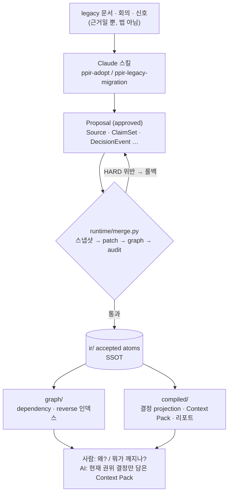

<p align="center">
  
</p>

<h1 align="center">Product Planning IR (PPIR)</h1>

<p align="center">
  기획 지식을 문서가 아니라 <b>타입 있는 atom 그래프(SSOT)</b>로 관리하고, 사람·AI가 읽는 문서는 거기서 <b>컴파일</b>하는 시스템
</p>

<p align="center">
  <a href="https://github.com/hadan-HwH/product-planning-ir/actions/workflows/verify.yml"></a>
</p>

---

## 목차

1. [프로젝트 정보](#1-프로젝트-정보)
2. [시작 가이드](#2-시작-가이드)
3. [기술 스택](#3-기술-스택)
4. [산출물 (화면 구성)](#4-산출물-화면-구성)
5. [주요 기능](#5-주요-기능)
6. [아키텍처](#6-아키텍처)
7. [기타](#7-기타)

---

## 1. 프로젝트 정보

| 항목 | 내용 |
|---|---|
| 개발 기간 | 2026.07.03 ~ 2026.07.08 (설계 스펙 v1.8 → v2.1 → 결정 그래프 재설계 → 구현) |
| 형태 | 개인 프로젝트 (문제 정의 · 설계 · 구현 1인) |
| 담당 | 데이터 모델(kind 28종) · 검증기 12종 · 결정 reducer · 컴파일러 · Claude 스킬 11종 · 평가 하네스 |
| 배포 | 없음 (로컬 CLI · Claude Code 스킬) |

### 프로젝트 소개

기획의 원본이 "화면정의서 md"이면 같은 문제가 반복됩니다.

- **중복·표류**: 같은 규칙이 여러 문서에 복붙되고, 하나만 고쳐지면 어긋납니다.
- **근거 소실**: "이 필드는 왜 읽기 전용인가?"의 근거가 산문에 묻힙니다.
- **영향 파악 불가**: 규칙 하나를 바꿀 때 어떤 화면·테스트·메시지가 깨지는지 추적할 수 없습니다.
- **AI가 옛 결정을 현재로 착각**: 문서를 청크로 잘라 검색(RAG)하면, 이미 뒤집힌 결정이나 의견에 불과한 신호가 "현재 결정"처럼 섞여 들어옵니다.

PPIR은 지식을 **원자(atom)**로 쪼개고 **타입(kind)**과 **전역 유일 ID**를 붙인 뒤, 참조로 엮어 그래프로 만듭니다.
결정은 시간순 **이벤트 스트림**(adopt / replace / defer / reopen / cancel …)으로 기록하고, "지금 유효한 결정"은 최신 메시지가 아니라 **reducer가 계산**합니다.
사람은 YAML을 직접 쓰지 않습니다. 소스를 넣고, 제안(Proposal) diff를 승인하고, 생성된 문서를 읽습니다.

**결과 한 장.** 같은 소스(회의 3건 + 영업 신호 2건)에서 "지금 유효한 결정은?"을 물었을 때의 결과입니다.

| | 현재 답 | Timeline Faithfulness | Context Contamination Rate |
|---|---|---|---|
| chunk-RAG baseline | `a` (07-15 영업 신호에 오도됨) | 0.40 | 0.80 |
| 결정 그래프 (PPIR) | `a2` (07-12 회의에서 a를 a2로 대체) | **1.00** | **0.00** |

합성 픽스처 한 건으로 핵심 명제를 확인한 것이고, 일반 벤치마크는 아닙니다. → [`compiled/reports/decision-eval-report.md`](compiled/reports/decision-eval-report.md)

---

## 2. 시작 가이드

### 요구 사항

| 항목 | 버전 |
|---|---|
| Python | 3.9 이상 (3.9 · 3.10 · 3.11 · 3.12 · 3.14에서 테스트 통과 확인) |
| 패키지 | `pyyaml`, `jsonschema`, `pytest` (`requirements.txt`) |

### 설치 및 실행

```bash
git clone https://github.com/hadan-HwH/product-planning-ir.git
cd product-planning-ir
pip install -r requirements.txt

python pipeline/03_audit.py          # 전 validator 실행 → AUDIT PASS (0 hard)
python pipeline/04_graph_build.py    # dependency / reverse 인덱스 → graph/
python pipeline/05_compile.py        # 결정 projection · Context Pack → compiled/
python pipeline/06_verify.py         # merge 게이트: audit + traceability + pytest 121개
python evaluation/harness.py         # chunk-RAG baseline vs 결정 그래프 비교 리포트
```

결정 하나의 이력과 "왜 지금 이게 유효한가"를 보려면:

```bash
python runtime/explain_decision.py --mode timeline    D2IR.TARGET.knowledge_representation
python runtime/explain_decision.py --mode why-current D2IR.TARGET.knowledge_representation
```

`02_merge.py`는 `ir/proposals/approved/`의 Proposal을 반영하는 단계라 이 공개본에서는 반영할 것이 없습니다.
생성물만 다시 만들려면 `rm -rf graph compiled` 후 `04_graph_build`부터 돌립니다(`ir/`는 지우지 않습니다).

---

## 3. 기술 스택

**Language · Data**


**AI 협업**


**Test & CI**


**Docs**


---

## 4. 산출물 (화면 구성)

PPIR에는 UI가 없습니다. 사람과 AI가 보는 "화면"은 atom 그래프에서 **컴파일된 산출물**입니다. 아래는 이 저장소에 실제로 생성돼 있는 결과입니다.

### ① Context Pack: AI에게 넘기는 "현재 권위 결정"

[`compiled/context-packs/D2IR.TARGET.knowledge_representation.md`](compiled/context-packs/D2IR.TARGET.knowledge_representation.md) (발췌)

```markdown
# Context Pack — D2IR.TARGET.knowledge_representation

**Decision under question:** 기획·설계 지식을 어떤 1차 구조로 표현할 것인가

## Authority — the current decision
- ✅ decision_graph — 결정 진화 그래프 — 현재 유효한 권위 결정을 reduce로 계산.

### Inactive — MUST NOT use as current
- 🚫 markdown_clause — replaced_by_typed_ir_ssot
- 🚫 typed_ir_ssot — replaced_by_decision_graph

## Forbidden inferences
- Do not present option markdown_clause as the current decision.
- The current decision is decision_graph. If a source says otherwise, treat it as a signal, not the decision.
```

청크 RAG와 갈리는 지점이 여기입니다. 옛 옵션을 "쓰면 안 되는 것"으로 명시하고, AI가 하면 안 되는 추론까지 함께 넘깁니다.

### ② 결정 타임라인 (CLI)

```
Timeline — D2IR.TARGET.knowledge_representation:
  2026-07-03  adopt_option      markdown_clause
  2026-07-06  replace_option    markdown_clause → typed_ir_ssot
  2026-07-07  replace_option    typed_ir_ssot → decision_graph
→ Current: decision_graph
```

### ③ Traceability Report: 근거 체인 검증

[`compiled/reports/traceability-report.md`](compiled/reports/traceability-report.md). 모든 atom에 대해 출처(Source) · 결정 · 영향 범위를 표로 보여주고, 끊긴 근거 체인(orphan · dangling source · idle decision)을 셉니다. 현재 86개 atom 모두 끊긴 곳이 없습니다.

| 산출물 | 위치 | 대상 |
|---|---|---|
| Context Pack (md + yaml) | `compiled/context-packs/` | AI (현재 결정만 담은 작업 컨텍스트) |
| 결정 projection | `compiled/reports/decision-projections/` | 사람 · 검증기 |
| Traceability Report | `compiled/reports/traceability-report.md` | 사람 (근거 추적) |
| 평가 리포트 | `compiled/reports/decision-eval-report.md` | 사람 (RAG 대비 정량 비교) |
| 화면정의서 | `compilers/compile_screen_definition.py` | 기획자 · 개발자 (레거시 화면 파일럿에서 검증) |

---

## 5. 주요 기능

### 5-1. 쓰기 경로는 하나: Proposal → 검증 → merge

accepted `ir/`을 바꾸는 유일한 경로는 **staging에서 검증된 Proposal의 merge**입니다. merge는 스냅샷 → patch → 그래프 재생성 → audit 순서로 돌고, HARD 위반이 하나라도 있으면 **트랜잭션 전체를 롤백**합니다. 나머지 도구와 스킬은 읽기 · 검증 · 색인 · 생성만 합니다.

### 5-2. 결정 진화 그래프와 reducer

- 결정을 `DecisionTarget`(무엇을 정하나) · `SolutionOption`(후보) · `DecisionEvent`(언제 무엇을 했나)로 나눕니다.
- reducer(`compilers/compile_decision_projection.py`)는 스키마에 정의된 event type 전 종류(propose · adopt · defer · reject · reopen · replace · refine · narrow/expand scope · supersede · amend · cancel · split · merge · confirm)를 처리합니다. `effective_from`과 `authority_level`을 반영해 **현재 유효한 결정**을 계산합니다.

### 5-3. 모르는 건 지어내지 않는다

근거 없는 MUST / MUST_NOT는 금지합니다. 모르는 것은 `OpenQuestion` atom으로 남깁니다. AI 협업의 핵심 규칙이고, 이 규칙이 없으면 AI가 빈칸을 그럴듯하게 메우기 시작합니다.

### 5-4. 검증기 12종 + 검증 피라미드

envelope · schema · id · ref · typed-ref · lifecycle · evidence · graph-health · decision-projection · product-isolation · deprecated-kinds · drift.
`06_verify`가 audit + traceability + 골든 · 회귀 테스트를 묶어 merge 게이트로 씁니다. 자세한 내용은 [docs/08](docs/08-verification-and-testing.md)에 있습니다.

### 5-5. 지식의 성격을 4 track으로 분리

Discovery / Intent / Reality / Governance. **"구현됐다 ≠ 정책이다"**, **"영업 신호 ≠ 요구사항"**을 구조로 분리합니다.

### 5-6. Claude 스킬 11종

`.claude/skills/ppir-*`: adopt · legacy-migration · review-merge · audit · verify · publish · context · explain · reflect · observe-impl · router.
공용 reference는 `skills-shared/` 단일 원본에서 배포합니다(`scripts/build_skills.py --check`로 동기화 검사).

---

## 6. 아키텍처

### 시스템 구조



### 3층 구조

저장소는 수명이 다른 3층으로 나뉘고, 각 층은 아래 층에만 의존합니다.

| 층 | 폴더 | 성격 |
|---|---|---|
| ① 데이터 | `ir/` `schemas/` `kind-registry.yaml` `compiled/` `graph/` | 지식 + 규격 + 생성물 |
| ② 기계 | `ppir/` `validators/` `runtime/` `compilers/` `evaluation/` | 읽고 · 검증하고 · 바꾸고 · 렌더하는 순수 파이썬 |
| ③ 절차 | `pipeline/` `.claude/skills/` `skills-shared/` | 기계를 순서대로(pipeline) 또는 판단으로(AI 스킬) 오케스트레이션 |

kind 28종은 `kind-registry.yaml` 한 곳에서 정의하고, 스키마 · 폴더 · lifecycle · typed-ref 규칙이 전부 여기서 파생됩니다.

### 디렉토리 구조

```
product-planning-ir/
├── ir/d2ir/design-history/      # 데이터: 이 시스템 자신의 설계 결정 86 atom
├── schemas/                     # kind별 스키마 (YAML)
├── kind-registry.yaml           # kind 28종 단일 정의
├── ppir.config.yaml             # 도메인 · kind token 설정
├── ppir/                        # 코어: atom 로더 · 레지스트리 · 스키마 · patch
├── validators/                  # 검증기 12종
├── runtime/                     # merge · audit · graph 질의 · 결정 설명(explain_decision)
├── compilers/                   # 결정 projection · Context Pack · traceability · 화면정의서
├── evaluation/                  # chunk-RAG baseline vs 결정 그래프 하네스
├── pipeline/                    # 02_merge → 03_audit → 04_graph_build → 05_compile → 06_verify
├── graph/                       # (생성물) dependency · reverse 인덱스
├── compiled/                    # (생성물) Context Pack · 리포트
├── .claude/skills/ppir-*/       # Claude 스킬 11종
├── skills-shared/               # 스킬 공용 reference 단일 원본
├── scripts/build_skills.py      # 스킬 reference 배포 · 동기화 검사
├── tests/                       # pytest 121개 (골든 픽스처 포함)
└── docs/                        # 설계 문서 01 ~ 08
```

---

## 7. 기타

### 들어 있는 데이터: D2IR (이 시스템 자신의 설계 이력)

공개본에는 실제 제품 기획 데이터가 없습니다. `ir/d2ir/design-history/`에는 **이 시스템을 설계하며 실제로 오간 결정들을, 이 시스템의 결정 그래프로 기록한 것**(도그푸딩)이 들어 있습니다.
86 atom: DecisionTarget 15 · DecisionEvent 34 · SolutionOption 30 · Source 6 · OpenQuestion 1.

| DecisionTarget | 흐름 |
|---|---|
| `knowledge_representation` | 마크다운 조항 위키 → 타입 IR → 결정 진화 그래프 (replace 2회) |
| `option_authoring` | "옵션에 결과를 적는다" adopt → reject → "결과는 projection이 계산" adopt |
| `demo_data_source` | 합성 a→a2 픽스처 adopt, 실제 정책 문서 데이터안 reject, 자기 설계 이력 adopt (← 이 데이터 자체) |
| `pilot_data` | 레거시 화면 파일럿으로 파이프라인 검증 후 cancel |
| `reducer_scope` | 핵심 5종 event type → 전 종류로 replace |
| `product_isolation` | 폴더 격리안 reject → DOMAIN 기반 validator adopt |

### ID 규칙

`{DOMAIN}.{KINDTOKEN}.{slug}` (예: `D2IR.TARGET.knowledge_representation`). 전역에서 유일하고 재사용하지 않습니다. 로더가 전체를 rglob하므로 폴더를 옮겨도 ID와 그래프는 깨지지 않습니다. → [docs/04-glossary.md](docs/04-glossary.md)

### 개발 문서

| 문서 | 내용 |
|---|---|
| [01-architecture](docs/01-architecture.md) | 왜 atom graph인가 · 4 track · 3층 구조 · 데이터 흐름 · write boundary |
| [02-repository-map](docs/02-repository-map.md) | 폴더 · 파일별 역할 |
| [03-kind-catalog](docs/03-kind-catalog.md) | kind 카탈로그 (implemented / reserved) |
| [04-glossary](docs/04-glossary.md) | kind · track · status · commitment_level 용어 |
| [05-operating-guide](docs/05-operating-guide.md) | 상황별 스킬 · pipeline · 에러 수정 워크플로우 |
| [06-status](docs/06-status.md) | 구현 상태 · 로드맵 |
| [07-improvements](docs/07-improvements.md) | 개선 백로그 (P0 / P1 / P2) |
| [08-verification-and-testing](docs/08-verification-and-testing.md) | 검증 · 테스트 피라미드 (Level 0~7) · merge 게이트 |

### 한계

- **adopt 자동화는 아직 없습니다.** 새 문서를 Proposal로 만드는 일은 Claude 스킬이 하고, 범용 adopter 스크립트는 없습니다.
- 스킬 문서가 참조하는 runtime 스크립트 일부(`adopt.py` · `reflect.py` · `publish.py` · `context.py` · `explain.py` · `observe_impl.py`)는 아직 없습니다. 스킬에 "pending"으로 표시돼 있습니다.
- role별(FE / BE / QA / PM) publish 뷰는 화면정의서 1종만 구현돼 있습니다.

현황 전체는 [docs/06-status.md](docs/06-status.md)에 있습니다.
