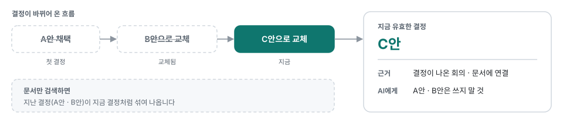
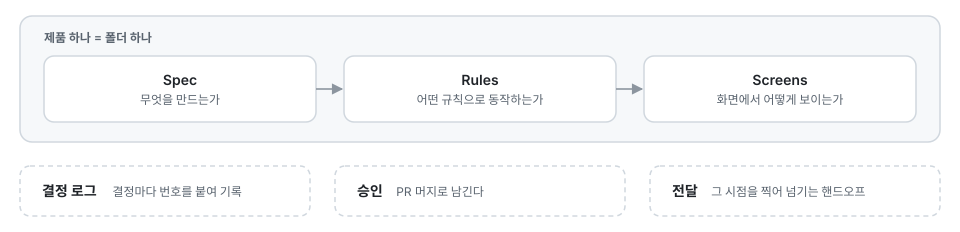

<p align="center">
  
</p>

<h1 align="center">Product Planning IR (PPIR)</h1>

<p align="center">
  기획 문서를 정리하기 위한 실험 ①<br>
  결정이 여러 번 바뀌어도 <b>지금 유효한 결정</b>이 무엇인지 바로 알 수 있게
</p>

<p align="center">
  <a href="https://github.com/hadan-HwH/product-planning-ir/actions/workflows/verify.yml">
    
  </a>
  
  <a href="https://github.com/hadan-HwH/living-knowledge-lab-engine"></a>
</p>

<p align="center"><sub>개인 연구 프로젝트</sub></p>

---

<picture>
  <source media="(prefers-color-scheme: dark)" srcset="assets/hero-dark.svg">
  
</picture>

## 왜 만들었나

기획 문서는 Slack · Notion · 회의록 · Word · Figma 에 흩어져 있었습니다. GitHub 의 Markdown 저장소 한곳으로 모으자 찾기는 쉬워졌습니다. 하지만 풀리지 않은 문제가 남았습니다.

- **같은 규칙이 여러 문서에 복사됩니다.** 한 곳을 고치면 나머지는 옛 내용으로 남습니다.
- **결정이 바뀌어도 옛 결정이 그대로 있습니다.** 어느 쪽이 지금 기준인지는 사람이 하나씩 확인해야 합니다.
- **AI 도 헷갈립니다.** 문서를 잘라 검색해서 답하는 AI(RAG)는 이미 뒤집힌 결정을 지금 결정처럼 가져옵니다.

PPIR 은 그 확인을 사람 대신 구조가 하도록 만들어 본 첫 번째 실험입니다. 기획 내용을 작은 단위로 쪼개 서로 연결하고, 결정은 순서대로 기록해 두었다가 <b>지금 유효한 결정을 계산해서</b> 알려 줍니다.

<picture>
  <source media="(prefers-color-scheme: dark)" srcset="assets/journey-dark.svg">
  
</picture>

## 하는 일

| 기능 | 설명 |
| --- | --- |
| **결정 이력** | 채택 · 교체 · 보류 · 재개를 순서대로 기록하고, 지금 유효한 결정을 계산합니다. |
| **근거 연결** | 모든 내용에 어디서 나온 결정인지를 붙이고, 근거가 끊긴 곳을 찾아냅니다. |
| **AI 에게 줄 맥락** | 지금 결정과 쓰면 안 되는 옛 결정을 구분해서 정리합니다. |
| **검증 후 반영** | 바꾸려는 내용은 제안 → 검증 → 반영 순서를 거치고, 검증에 실패하면 통째로 되돌립니다. |
| **모르는 것은 질문으로** | 근거가 없는 내용은 지어내지 않고 '아직 정하지 않은 질문'으로 남깁니다. |

## 예시로 보기

공개 데모에는 PPIR 자신의 설계 결정이 데이터로 들어 있습니다. "지식을 어떤 형태로 담을 것인가"라는 결정은 두 번 뒤집혔습니다.

```
지식을 어떤 형태로 담을 것인가
  채택   Markdown 조항
  교체   Markdown 조항 → 타입이 있는 구조
  교체   타입이 있는 구조 → 결정 그래프
→ 지금 유효: 결정 그래프
```

이 기록에서 PPIR 은 AI 에게 넘길 맥락을 이렇게 만들어 냅니다. 지금 결정은 하나만 남기고, 지난 결정에는 "쓰지 말 것"을 붙입니다.

```markdown
# Context Pack — D2IR.TARGET.knowledge_representation

## Authority — the current decision
- ✅ decision_graph — 결정 진화 그래프

### Inactive — MUST NOT use as current
- 🚫 markdown_clause — replaced_by_typed_ir_ssot
- 🚫 typed_ir_ssot — replaced_by_decision_graph
```

### 문서 검색과 비교

같은 자료(회의 3건, 영업 의견 2건)를 주고 "지금 유효한 결정은 무엇인가"를 물었습니다. 문서 검색은 나중에 나온 영업 의견에 끌려가 틀린 결정을 골랐습니다.

| 방식 | 지금 결정 | 이력 정확도 | 옛 결정이 섞인 비율 |
| --- | :---: | :---: | :---: |
| 문서 검색(RAG) | 틀림 | 0.40 | 0.80 |
| **PPIR** | **맞음** | **1.00** | **0.00** |

<sub>핵심 동작을 확인하는 합성 시나리오 기준입니다.</sub>

## 어떻게 만들었나

<picture>
  <source media="(prefers-color-scheme: dark)" srcset="assets/flow-dark.svg">
  
</picture>

- **원본은 그래프 하나**: 문서와 리포트는 모두 그래프에서 만들어 냅니다. 같은 내용을 두 곳에 쓰지 않습니다.
- **결정은 계산한다**: 가장 최근 글을 믿지 않고, 결정 기록을 순서대로 따라가 지금 상태를 구합니다. 언제부터 효력이 있는지, 누가 정할 수 있는 결정인지도 함께 봅니다.
- **검증을 통과해야 반영**: 형식 · 참조 · 이력을 보는 검증 12종과 테스트를 통과한 변경만 들어갑니다.
- **사실과 방침을 섞지 않는다**: 탐색 · 의도 · 구현 · 관리 네 갈래로 나눠, "이미 이렇게 만들어져 있다"와 "이렇게 하기로 했다"를 구분합니다.

## 구성

| 층 | 위치 | 역할 |
| --- | --- | --- |
| **데이터** | `ir/` · `schemas/` · `kind-registry.yaml` | 지식 단위와 타입 정의 |
| **처리** | `ppir/` · `validators/` · `runtime/` · `compilers/` | 읽기 · 검증 · 반영 · 문서 생성 |
| **절차** | `pipeline/` · `.claude/skills/` | 단계별 실행과 Claude 스킬 |
| **생성물** | `graph/` · `compiled/` | 의존 관계 색인 · AI 용 맥락 · 리포트 |

```
product-planning-ir/
├── ir/d2ir/          # 데모 데이터: PPIR 자신의 설계 결정
├── schemas/          # 타입별 스키마
├── ppir/             # 지식 단위 읽기 · 레지스트리 · 변경 적용
├── validators/       # 검증기 12종
├── runtime/          # 반영 · 감사 · 결정 이력 조회
├── compilers/        # AI 용 맥락 · 결정 상태 · 근거 추적 · 화면정의서 생성
├── evaluation/       # 문서 검색(RAG) 대비 평가
├── pipeline/         # 감사 → 그래프 생성 → 문서 생성 → 검증
├── .claude/skills/   # Claude 스킬
└── tests/            # 테스트
```

## 검증

모든 변경은 아래 검증을 통과해야 반영되며, 같은 검증을 GitHub Actions 에서 push 마다 실행합니다.

| 단계 | 확인 내용 |
| --- | --- |
| **감사** | 형식 · ID · 참조 · 수명 주기 · 근거 등 검증 12종 |
| **근거 추적** | 모든 항목이 출처와 결정에 연결되어 있고, 끊긴 연결이 없는지 |
| **회귀 테스트** | 기준 데이터에서 결정 계산 결과가 유지되는지 |

## 배운 것

- **쓰는 부담이 컸습니다.** 가벼운 메모부터 확정된 결정까지 같은 형식으로 써야 해서, 사람이 계속 유지하기 어려웠습니다.
- **넣는 길이 좁았습니다.** 이미 있는 문서를 이 구조로 옮기는 일은 손으로 해야 했습니다.
- **꺼내 쓰는 길을 더 만들어야 했습니다.** 그래프에서 문서를 만들어 내는 기능은 화면정의서 한 종류까지 만들었습니다.

그래서 다음 실험 [LKL](https://github.com/hadan-HwH/living-knowledge-lab-engine)에서는 방향을 바꿔, <b>이미 써 둔 문서와 코드에서 구조를 뽑아내는 방식</b>을 시도했습니다.

## 그래서 팀 문서는 이렇게 쓰기로 했습니다

<picture>
  <source media="(prefers-color-scheme: dark)" srcset="assets/team-dark.svg">
  
</picture>

실험을 거쳐, 팀의 기획 문서는 사람이 쓰고 읽기 쉬운 단순한 구조로 정리했습니다.

- **제품 하나에 폴더 하나, 문서는 세 가지**: 무엇을 만드는지(Spec), 어떤 규칙으로 동작하는지(Rules), 화면에서 어떻게 보이는지(Screens)를 나눠 씁니다. 같은 사실은 한 문서에만 쓰고 나머지는 인용합니다.
- **결정은 번호를 붙여 남긴다**: 회의록 대신 결정 로그에 배경과 결정을 함께 적고, 문서에 반영됐는지까지 따라갑니다.
- **승인은 PR 머지**: 누가 언제 승인했는지가 저장소에 그대로 남습니다.
- **다른 팀에는 핸드오프로**: 계속 바뀌는 문서를 보여 주지 않고, 그 시점을 찍어서 넘깁니다.

## 실행 방법

<details>
<summary><b>명령 보기</b></summary>

<br>

Python 3.9 이상 환경이 필요합니다.

```bash
git clone https://github.com/hadan-HwH/product-planning-ir.git
cd product-planning-ir
pip install -r requirements.txt

# 검증 실행 (전체 검증기 + 근거 추적 + 테스트)
python pipeline/06_verify.py

# 문서 검색(RAG) 대비 평가
python evaluation/harness.py

# 결정 하나의 변경 이력 조회
python runtime/explain_decision.py --mode timeline D2IR.TARGET.knowledge_representation
```

</details>

## 기술 및 문서

**Python 3.9+ · YAML · JSON Schema · pytest · GitHub Actions · Claude Code 스킬**

| 문서 | 내용 |
| --- | --- |
| [Architecture](docs/01-architecture.md) | 그래프 구조, 데이터 흐름 |
| [Operating Guide](docs/05-operating-guide.md) | 파이프라인과 스킬 사용법 |
| [Verification](docs/08-verification-and-testing.md) | 검증 체계와 테스트 |

<sub>공개 저장소에는 실제 제품 기획 데이터가 없으며, PPIR 자신의 설계 이력만 데모 데이터로 들어 있습니다.</sub>
