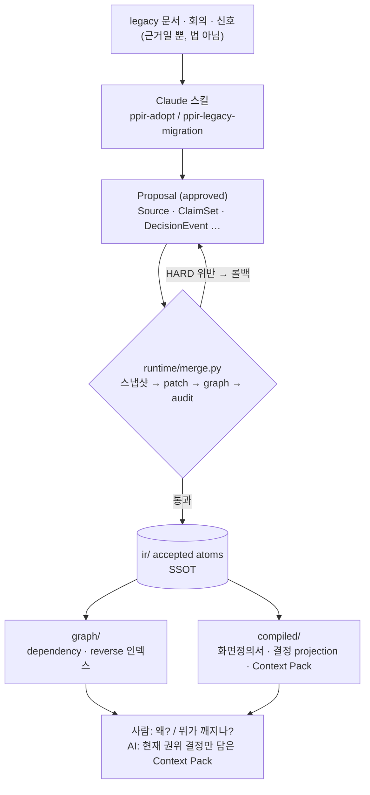

# Product Planning IR (PPIR)

기획 지식을 **문서(md)가 아니라 타입 있는 atom 그래프(SSOT)** 로 관리하고, 사람·AI가 읽는 문서는 거기서 **컴파일**한다.
원칙적으로 사람은 YAML을 직접 쓰지 않는다 — 소스를 넣고, 제안(Proposal) diff를 승인하고, 생성된 뷰를 읽는다.

> **이 저장소에 대해.** 엔진·스키마·검증기·컴파일러·스킬과 설계 문서를 담은 공개본이다. 실제 제품 기획 데이터는 포함하지 않는다.
> 들어 있는 데이터(`ir/d2ir/`)는 **이 시스템을 만들면서 내린 설계 결정들을 이 시스템 자신의 결정 그래프로 기록한 것**(도그푸딩)이다.

---

## 왜 만들었나

기획의 원본이 "화면정의서 md"이면 같은 문제가 반복된다.

- **중복·표류** — 같은 규칙이 여러 문서에 복붙되고, 하나만 고쳐지면 어긋난다.
- **근거 소실** — "이 필드는 왜 읽기전용인가?"의 근거가 산문에 묻힌다.
- **영향 파악 불가** — 규칙 하나 바꿀 때 어떤 화면·테스트·메시지가 깨지는지 추적할 수 없다.
- **AI가 옛 결정을 현재로 착각** — 문서를 청크로 잘라 검색(RAG)하면, 이미 뒤집힌 결정이나 아직 신호일 뿐인 의견이 "현재 결정"처럼 섞여 들어온다.

PPIR은 지식을 **원자(atom)** 로 쪼개 **타입(kind)** 과 **전역 유일 ID**를 붙이고, 참조로 엮어 그래프를 만든다. 규칙은 한 atom에만 살고, 결정·근거·출처는 별도 atom으로 남아 체인으로 이어진다.
특히 결정은 **시간순 이벤트(adopt / replace / defer / reopen / cancel …)의 스트림**으로 기록하고, "지금 유효한 결정"은 최신 메시지가 아니라 **reducer가 계산**한다.

### 결과 한 장

같은 소스(회의 3건 + 영업 신호 2건)에서 "지금 유효한 결정은?"을 물었을 때 (`tests/fixtures/decision-evolution-a-to-a2/`, `python evaluation/harness.py`):

| | 현재 답 | Timeline Faithfulness | Context Contamination Rate |
|---|---|---|---|
| chunk-RAG baseline | `a` (07-15 영업 신호에 오도됨) | 0.40 | 0.80 |
| 결정 그래프 (PPIR) | `a2` (07-12 회의에서 a를 a2로 대체) | **1.00** | **0.00** |

합성 픽스처 한 건으로 핵심 명제를 증명한 것이지 일반 벤치마크는 아니다. 리포트: [`compiled/reports/decision-eval-report.md`](compiled/reports/decision-eval-report.md).

---

## 절대 규칙 (지키지 않으면 시스템이 무너짐)

1. **`ir/`의 atom만 원본이다.** `sources/`의 마크다운은 *근거(evidence)* 일 뿐 법이 아니다.
2. **`compiled/`·`graph/`는 손대지 않는다.** 전부 생성물 — atom을 고치고 다시 컴파일한다.
3. **모든 쓰기는 Proposal을 통한다.** accepted `ir/`을 바꾸는 유일한 경로는 **staging에서 검증된 뒤 이뤄지는 `merge`** 다. 그 외 모든 도구·스킬은 **읽기·검증·색인·생성**만 한다.
4. **모르는 것은 지어내지 말고 `OpenQuestion`으로 남긴다.** ← AI 협업의 핵심. 이 규칙이 없으면 AI가 빈칸을 그럴듯하게 메우기 시작한다. 근거 없는 MUST/MUST_NOT는 금지.

MVP 단계에서는 maintainer가 seed 작성·schema 보강을 위해 YAML을 직접 쓸 수 있지만, accepted IR 직접 수정이 아니라 Proposal 생성 또는 코드 개발로 제한한다([05-operating-guide.md](docs/05-operating-guide.md)).

---

## 구조



리포는 수명이 다른 3층으로 나뉘고, 각 층은 아래 층에만 의존한다.

| 층 | 폴더 | 성격 |
|---|---|---|
| ① 데이터 | `ir/` `schemas/` `kind-registry.yaml` `compiled/` `graph/` | 지식 + 규격 + 생성물 |
| ② 기계 | `ppir/` `validators/` `runtime/` `compilers/` `evaluation/` | 읽고·검증하고·바꾸고·렌더하는 순수 파이썬 |
| ③ 절차 | `pipeline/` `.claude/skills/` `skills-shared/` | 기계를 순서대로(pipeline) 또는 판단으로(AI 스킬) 오케스트레이션 |

- **kind 28종**을 `kind-registry.yaml` 한 곳에서 정의하고, 스키마·폴더·lifecycle·typed-ref 규칙이 전부 여기서 파생된다.
- **validator 12종**: envelope·schema·id·ref·typed-ref·lifecycle·evidence·graph-health·decision-projection·product-isolation·deprecated-kinds·drift.
- **4 track**(Discovery / Intent / Reality / Governance)으로 "구현됐다 ≠ 정책이다", "영업 신호 ≠ 요구사항"을 구조적으로 분리한다.
- **Claude 스킬 11종**(`.claude/skills/ppir-*`): adopt·legacy-migration·review-merge·audit·verify·publish·context·explain·reflect·observe-impl·router. 공용 reference는 `skills-shared/` 단일 원본에서 배포된다.

---

## 실행

```bash
pip install -r requirements.txt

python pipeline/03_audit.py          # 전 validator — AUDIT PASS (0 hard)
python pipeline/04_graph_build.py    # dependency / reverse 인덱스 → graph/
python pipeline/05_compile.py        # 결정 projection · Context Pack → compiled/
python pipeline/06_verify.py         # merge 게이트: audit + traceability + pytest
python evaluation/harness.py         # chunk-RAG baseline vs 결정 그래프 비교 리포트
```

결정 하나의 이력과 "왜 지금 이게 유효한가"를 보려면:

```bash
python runtime/explain_decision.py --mode timeline    D2IR.TARGET.knowledge_representation
python runtime/explain_decision.py --mode why-current D2IR.TARGET.knowledge_representation
```

```
Timeline — D2IR.TARGET.knowledge_representation:
  2026-07-03  adopt_option      markdown_clause
  2026-07-06  replace_option    markdown_clause → typed_ir_ssot
  2026-07-07  replace_option    typed_ir_ssot → decision_graph
→ Current: decision_graph
```

`02_merge.py`는 `ir/proposals/approved/`의 Proposal을 반영하는 단계라 이 공개본에서는 반영할 것이 없다. 생성물만 다시 만들려면 `rm -rf graph compiled` 후 `04_graph_build`부터 돌린다(`ir/`는 지우지 않는다).

---

## 들어 있는 데이터 — D2IR (이 시스템 자신의 설계 이력)

`ir/d2ir/design-history/` — 86 atom (DecisionTarget 15 · DecisionEvent 34 · SolutionOption 30 · Source 6 · OpenQuestion 1).
이 시스템을 설계하며 실제로 오간 결정들을, 이 시스템의 결정 그래프 모델로 기록했다. 예:

| DecisionTarget | 흐름 |
|---|---|
| `knowledge_representation` | 마크다운 조항 위키 → 타입 IR → 결정 진화 그래프 (replace 2회) |
| `option_authoring` | "옵션에 결과를 적는다" adopt → reject → "결과는 projection이 계산" adopt |
| `demo_data_source` | 합성 a→a2 픽스처 adopt, 실제 정책 문서 데이터안 reject, 자기 설계 이력 adopt (← 이 데이터 자체) |
| `pilot_data` | 레거시 화면 파일럿으로 파이프라인 검증 후 cancel |
| `reducer_scope` | 핵심 5종 event_type → 16종 전부로 replace |
| `product_isolation` | 폴더 격리안 reject → DOMAIN 기반 validator adopt |

각 타깃의 현재 결정은 `compiled/context-packs/`에 AI용 Context Pack(현재 권위 결정 + 쓰면 안 되는 옛 옵션 + 금지 추론)으로 컴파일돼 있다.

---

## ID 규칙

`{DOMAIN}.{KINDTOKEN}.{slug}` — 예: `D2IR.TARGET.knowledge_representation`. 전역 유일, 재사용 금지. 폴더를 옮겨도 ID·그래프는 안 깨진다(로더가 전체 rglob). 상세는 [04-glossary.md](docs/04-glossary.md).

---

## 문서 지도

| 문서 | 담는 것 |
|---|---|
| [docs/01-architecture.md](docs/01-architecture.md) | 왜 atom graph인가 · 4 track · 3층 구조 · 데이터 흐름 · write boundary |
| [docs/02-repository-map.md](docs/02-repository-map.md) | repo 상세 구조 · 폴더/파일별 역할 |
| [docs/03-kind-catalog.md](docs/03-kind-catalog.md) | kind 카탈로그 (implemented/reserved 상태 포함) |
| [docs/04-glossary.md](docs/04-glossary.md) | kind/track/status/commitment_level 용어 |
| [docs/05-operating-guide.md](docs/05-operating-guide.md) | 상황별 스킬 · pipeline · ownership·current-law 규칙 · 에러 수정 워크플로우 |
| [docs/06-status.md](docs/06-status.md) | 구현 상태 · 미완/로드맵 |
| [docs/07-improvements.md](docs/07-improvements.md) | 개선 백로그 (P0/P1/P2) |
| [docs/08-verification-and-testing.md](docs/08-verification-and-testing.md) | 검증·테스트 피라미드 (Level 0~7) · merge 게이트 |

---

## 한계 (솔직하게)

- **adopt 자동화는 미구현이다.** 새 문서를 Proposal로 만드는 건 Claude 스킬이 하고, 범용 adopter 스크립트는 없다.
- 스킬 문서가 참조하는 runtime 스크립트 일부(`adopt.py`·`reflect.py`·`publish.py`·`context.py`·`explain.py`·`observe_impl.py`)는 아직 없다 — 스킬에 "pending"으로 표시돼 있다.
- role별(FE/BE/QA/PM) publish 뷰는 화면정의서 1종만 구현돼 있다.

현황 전체는 [docs/06-status.md](docs/06-status.md).
